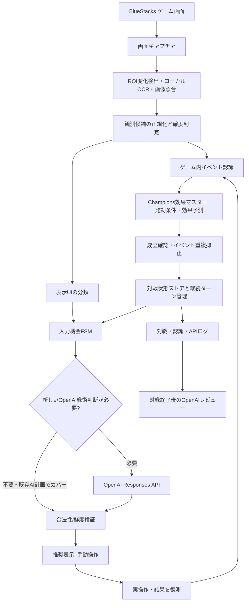

# Pokémon Champions リアルタイムAI対戦支援システム — 統合設計書 v2.0

- 作成日: 2026-10-21
- 対象: Windows PC / Androidエミュレータ（BlueStacks等） / Pokémon Champions シングル・ランクマッチ
- 位置づけ: v1.0（全体構成）、v1.1（試合ライフサイクル）、v1.2（S05）、v1.3（API契約）、v1.4（UI認識）、v1.5（イベント・継続ターン）の**統合・差分修正仕様**
- 戦術LIVEルールの**唯一正本**: `Pokemon_Champions_MC_live_decision_gate.txt`
- 現行構築の正本: `Pokemon_Champions_MC_team_2026-10-03.csv`
- 実測で未確認のChampions固有仕様は、一般的なポケモン知識で補完しない。

## 0. 採用した最重要原則

1. **選出・18対面PREP・技選択・任意の交代先・死に出し・試合後の戦術分析はOpenAIが判断する。** Pythonは戦術的な代案を独自決定しない。
2. **画面取得・文字/アイコン認識・事実記録・効果算出・継続ターン・入力機会管理・合法性確認はローカル。** 通常運用では状態認識にOpenAIを使わない。
3. 状態更新は `発動源の検出 → Champions効果マスターで期待効果を算出 → 成立/不成立を観測 → 1度だけ反映 → 表示と照合` が基本。画面テキストは効果計算の代替ではなく、**成立確認・不一致検出・検出漏れ補助**にも使う。
4. UI分類と、なぜそのUIに来たかを示す判断文脈は独立。**通常交代/とんぼがえり後/ひんし後/効果交代のポケモン選択UIは共通 `PARTY_MENU`** として認識し、状態履歴から判断理由を分類。
5. APIは「新しい戦術判断が必要になった入力機会」で呼ぶ。ターンが進んだだけ、相手が技を使っただけ、HPが動いただけでは呼ばない。既存のOpenAI判断が後続の選択を有効にカバーしていれば再利用可。
6. ゲーム操作はプレイヤー自身。API応答を受けたことと、技・交代がゲーム内で実行されたことは別。
7. 認識根拠がない事実・技/特性の追加効果・相手持ち物・残りターンを**確定扱いにしない**。事実／候補／不明を分ける。
8. リアルタイム制限、参照優先度、ルックアップ参照上限、完了判定は既存LIVE判断ゲートに従う。重複する独自LIVEルールを本書内に作らない。

## 1. 全体アーキテクチャ



### コンポーネントと責務

| モジュール | 主な責務 | OpenAI呼出 |
|---|---|---|
| `capture_service` | BlueStacksゲーム領域取得、フレームリングバッファ | なし |
| `perception_service` | UI・ポケモン名・技名・HP・メッセージ/詳細状態の認識 | 原則なし |
| `event_normalizer` | OCR訂正候補とChampions辞書照合、イベントID/発動源/対象の付与 | なし |
| `effect_engine` | 技/特性/持ち物の効果予測と発動条件検証、持続候補計算 | なし |
| `battle_state_store` | 判明技、HP、能力、残り3匹、場、ターン、技固定、根拠の保持 | なし |
| `ui_window_fsm` | 画面UIの識別と新入力機会の確定 | なし |
| `decision_orchestrator` | API入力形成・重複防止・期限制御・応答の検証 | 必要時 |
| `overlay_ui` | 推奨技/交代先/警戒と現在の認識状態を表示 | なし |
| `log_review` | 不変ログ、試合後分析、改善候補 | レビュー時 |

## 2. ゲーム進行（外側の状態FSM）

```text
S00 WAIT_START
  -> S01 PRELOAD_4_FILES
  -> S02 MATCHMAKING
  -> S03 TEAM_SELECTION (OpenAI選出)
  -> S04 PREP_40S (OpenAIの18対面/勝ち筋評価)
  -> S05 IN_BATTLE (入力機会ごとのOpenAI判断)
  -> S06 MATCH_END_COMMIT (勝敗/ログ確定、旧API失効)
  -> S07 REVIEW (OpenAI振り返り)
  -> S08 NEXT_MATCH_READY
  -> S01 (新しい開始指示で必須4本文を再読込) ...
```

- **S01**: ①LIVEゲート、②LIVE選出マトリクス、③60秒ルックアップ、④現行構築の**本文実読込4/4成功**でのみ事前ロード完了。ファイル存在確認だけでは不可。各試合開始指示ごとに新しい読込証拠を作る。
- **S03**: 相手6匹を認識し、マトリクスの対象6行を**1回だけ取得**。明示処理役を確認してOpenAIに選出3匹＋初手を決定させる。選出確定後は選出変更を提案しない。
- **S04**: 選出回答直後、初手6＋控え12対面と勝ち筋3点をOpenAIが評価。判断が割れたときだけ60秒ルックアップを原則2対面まで補完利用。40秒で必須PREP打切り、相手初手出現時には即終了。未完成は未完成としてログ化。
- **S05**: 戦術的な入力機会ごとにOpenAIへ依頼。ゲーム進行をローカルで継続監視し、対戦中のWebや固定ファイルの再読込は禁止。
- **S06/S07**: 旧ジョブ失効、全イベントのスナップショット保存、OpenAIで振り返り。既存ルール実行ミス/認識ミス/ユーザーの操作ミス/新改善候補を分離する。
- **S08**: 旧試合の盤面・残HP・技固定・未確定ジョブ・PREPを新試合へ持ち越さない。長期統計・検証済みの改善候補のみ保持する。レビュー中に新試合が始まれば、新試合優先でレビューは保留。

## 3. S05：入力機会単位の状態機械

### 3.1 画面UIと判断文脈を分離

| `visual_ui`（画像から認識） | 意味 | 交代理由の分類 |
|---|---|---|
| `COMMAND_MENU` | 技/通常交代を選ぶ入口 | `NORMAL_COMMAND` |
| `MOVE_MENU` | 技一覧/技詳細 | 同一の`NORMAL_COMMAND`窓が継続 |
| `PARTY_MENU` | 共通の自軍ポケモン一覧 | **保持済みイベントから推定**。UI自体は同じ |
| `ACTION_RESOLUTION` | 技/演出/効果発動中 | 原則、判断窓なし。ただしこの間の新たな選択UI出現は即認識 |
| `RESULT_SCREEN` | 勝敗確定 | 戦術ジョブ失効→S06 |
| `UNKNOWN` | 根拠不足 | 新しい判断窓を捏造しない |

`PARTY_MENU`に対する`decision_kind`:

- `NORMAL_COMMAND` のポケモン一覧: 元の入力機会が継続。既存のOpenAI判断を表示、追加APIなし。
- `PIVOT_TARGET`（自分のとんぼがえり等が成功）: 事前のOpenAIが予定交代先を判断済みで、**予定が合法かつ戦術判断に関わる盤面変化がない**なら再利用。そうでなければOpenAIで追加判断。
- `FAINT_REPLACEMENT`（自軍ひんし後）: 新しい入力機会。**OpenAIが次に出す1匹と温存する1匹を比較**して判断。
- `EFFECT_REPLACEMENT`（効果による選択式交代）: 実際に選択可能UIが現れた場合だけ、新規/再利用OpenAI判断。
- 相手の`ほえる`等によるランダム強制交代: 交代先を**こちらが選べない**なら判断窓なし。結果を記録し、次の入力時にOpenAI。
- 原因不明: `UNKNOWN_CONTEXT` として局所履歴/表示を再照合。画面だけでひんし/とんぼ後などを推測断定しない。

### 3.2 判断APIの発火条件

```text
(実際に操作可能なUIを安定検出)
AND (新しい decision_window_id が発行された)
AND (選択候補と現在の対戦状態に矛盾なし)
AND (当該選択をカバーする有効なOpenAI判断がない)
AND (対戦が継続し入力期限内)
=> OpenAIの戦術判断APIを送信
```

- 1ターン中の判断窓数は 0 / 1 / 複数。**ターン数をAPI回数に直結させない**。
- 新窓への移行は、同じ画面を複数フレームOCRしたことでは発生させない。
- 別の通常コマンド窓が新しく開いたなら、盤面がほぼ同じでも新しいOpenAI判断が必要。
- ひんし後の投入先判断と、その後に実際に技入力が開いたときの技判断は**別窓**。
- 画面の切替・カーソル移動・情報オーバーレイは同一窓の継続。

### 3.3 判断結果の鮮度と安全性

API要求/応答に以下を含める。

- `match_id`: 試合ID
- `decision_window_id`: 入力機会ID
- `tactical_state_version`: 推奨に関わる盤面の版
- `allowed_action_digest`: 合法候補とこだわり固定等の検証指紋
- `deadline_ms_remaining`: 入力期限の残り

受信結果が現行値と一致しなければ**古い推奨を表示しない**。合法性に反する出力なら無効。Pythonが別の技や交代先を考えて代案にすることは禁止。期限内ならOpenAIへ再問い合わせ、間に合わなければ「判断未確定」。通信中も画像監視は継続する。

## 4. 事実認識と効果計算の統合（今回の主要変更）

### 4.1 5段階パイプライン

```text
(1) 観測：技名・特性名・持ち物名・動作・下部テキストを捕捉
       ↓
(2) 効果マスター照合：発動条件、対象、予測結果、効果発生タイミングを算出
       ↓
(3) 成立判定：成功/失敗/命中/無効/追加効果/能力変化表示/HP変化を照合
       ↓
(4) 確定イベントを1回だけ状態ストアへ適用
       ↓
(5) アイコン・詳細表示・次画面と照合し、矛盾を検出
```

**重大な注意**:
- 「わざを使用した」は「すべての効果が発生した」を意味しない。
- 技の使用に伴う確定的な効果は成立を確認して反映。追加効果・特性の条件付き効果は発動が観測されるまで未確定。
- 全ての技・特性・持ち物が現マスターだけで完全に機械可読とは限らない。不明な効果を別作品から補完しない。
- テキスト側が能力変化を明確に示したときは、技の計算結果が矛盾すれば**原因を再確認**。両方を加算しない。

### 4.2 効果マスター（新規追加）の役割

元データ:
- `Pokemon_Champions_MC_move_master.csv`: 技名・威力・命中・優先度・フラグ等。**全技の能力変化量/効果成立条件/継続ターンの構造化は未完備**。
- `Pokemon_Champions_MC_ability_master.csv` + `Pokemon_Champions_MC_ability_ai_master.txt`: Champions特性効果と構造化済みサブセット。
- `Pokemon_Champions_MC_usable_held_items.csv` + `Pokemon_Champions_MC_held_item_ai_master.txt`: 道具と一部構造化済み効果。
- 使用可能ポケモン・習得技・フォームなどのChampions固定マスター。

**新規** `Pokemon_Champions_effect_rules.jsonl` は元データを置き換える正本ではなく、Champions専用の検証済み仕様を結合した**機械可読派生/補完マスター**とする。

レコードに必要な項目:

| 項目 | 内容 |
|---|---|
| `rule_id,source_type,source_key` | 技/特性/持ち物の出所、キー |
| `trigger` | 技成功・命中時・場に出た時・ターン終了時など |
| `conditions` | 命中、対象、天候、HP、例外/無効条件 |
| `effects` | 能力段階・状態・HP・設置技・壁・天候・フィールド・タイプ等 |
| `duration` | 有無、通常ターン、道具等で延長される候補 |
| `expiration` | ターン終了/交代/解除技/上書き/ひんし等 |
| `observation_required` | 成立確認用の技ログ・追加効果メッセージ・アイコン等 |
| `confidence` | confirmed / partial / unknown |
| `source_ref,verified_at,regulation` | Champions固有出典、確認日、適用レギュ |

簡略例（設計例。実装にはChampionsマスターとの照合が必要）:

```json
{"rule_id":"MOVE_DRAGON_DANCE","source_type":"move","source_key":"りゅうのまい","trigger":"MOVE_SUCCESS","effects":[{"kind":"stat_stage","target":"self","stat":"atk","delta":1},{"kind":"stat_stage","target":"self","stat":"spe","delta":1}],"observation_required":"move_success","confidence":"to_verify_in_effect_master"}
```

### 4.3 戦闘メッセージ辞書の役割

`Pokemon_Champions_battle_message_patterns.jsonl` を独立した補助辞書として保持する。

- 主目的は `MOVE_USED`/`ABILITY_ACTIVATED`/`ITEM_CONSUMED`/`STATUS_APPLIED`/`SCREEN_ENDED` など、発動/成立/消失イベントの検出。
- 「ぐーんと」「がくっと」「ぐぐーんと」「がくーんと」などの能力変化表現は、**技等から算出したランク変化の照合と、発動源の認識を失敗した場合のフォールバック**にする。
- すべての辞書表現は実際のChampions日本語UIから録画採取・検証する。表記ゆれを他作品の文言で無条件補完しない。
- 「数段階以上」など変化量を一意に確定できない表現は、`min/max/candidates`として保持。技/特性/現在ランクの証拠がないまま固定値にしない。
- 1回の技で複数の能力や対象に変化がある場合は、**効果単位**で登録。OCRを複数回見たからといって加算しない。

### 4.4 同一効果の二重計上防止

`effect_instance_id = match_id + actor + activation_event_id + effect_rule_id + target + effect_index` のような一意キーを付与する。OCRフレームIDではなく、**ゲーム内の1回の効果発動エピソード**に紐づける。

- 予測イベントは`PENDING`。実際の成立を確認した効果だけ`CONFIRMED`として適用。
- 同一効果の「技発動メッセージ」と「能力が上がったメッセージ」は**同じ効果の2証拠**であり別々に加算しない。
- 同じ文章が後のターンで改めて表示されたら、新しいactivation_event_idで別の効果とする。
- 成立せず`FAILED/NEGATED`になった候補は適用しない。
- 状態が矛盾した場合は確認情報を消さず、`RECONCILIATION_REQUIRED`にする。再生バッファ・詳細表示・手動訂正で解決。

## 5. ターン・持続効果・状態の保持

### 5.1 状態項目の所有単位

| 保持対象 | 所有単位 | 更新トリガー |
|---|---|---|
| HP、状態異常、能力ランク、フォーム、タイプ、技固定 | 個体（activeでなくポケモン個体ID） | 行動、交代、メガ、状態変化、実測 |
| 相手の判明技・道具・特性、実測S関係 | 個体＋証拠履歴 | 技表示、特性発動、持ち物、行動順 |
| ステルスロック、壁、まきびし等 | 自軍側 / 相手側 | 設置、解除、消滅 |
| 天候・フィールド | 戦場全体 | 発動、上書き、解除、ターン終了 |
| フィールド/天候/壁の残り候補 | 各効果インスタンス | 発動、`TURN_END_CONFIRMED`、上書き/消滅 |
| 観測根拠・推測候補 | イベント/効果インスタンス | 認識・照合・訂正 |

能力変化と技固定は、入れ替わった個体に引き継がない。既存のChampions仕様に従う交代・フォーム更新を実施。設置技と壁は交代しても陣営側に残る。

### 5.2 継続ターンの基本ルール

既存v1.5においてChampions専用資料で確認した基礎値を効果マスターに保持する:

- 天候: 通常5ターン、該当の延長いわで8ターン。
- フィールド: 通常5ターン、グランドコートで8ターン。
- ひかりのかべ/リフレクター/オーロラベール: 通常5ターン、ひかりのねんどで8ターン。
- ステルスロックなどの設置技: 5/8ターンのタイマーではなく、解除の成立まで保持（技ごとのChampions定義を個別確認）。

**対戦相手の延長持ち物が不明なら `[5,8]` の両候補を保持**。UIの残りターン表示が未知の延長候補を隠す場合があるため、表示数値だけで持ち物なしを断定しない。既存v1.5はChampions固有解説にこの注意が記載されている。

- 効果発動したターンも持続ターンに含める。例：第7ターンに壁成立→第7ターン終了時、通常残り4 / 延長残り7。
- `TURN_END_CONFIRMED(turn_id)` は同一ターンに**1回だけ**。とんぼ交代先選択・ひんし投入・アニメ表示では減算しない。
- 発動源が持ち物を含め不明な場合、候補残ターンを計算し、明示終了表示/上書き/解除を優先する。
- ターン境界を取りこぼした場合は残ターンを「確定」とせず、候補の範囲または`unknown`へ降格。
- 詳細情報表示と計算が異なれば根拠を保存して再照合。明示的な消滅・終了観測は予測より優先。

## 6. OpenAI APIの入力・出力契約

### 6.1 指示を3層に分離

1. **安定した共通指示**: Champions専用・LIVE判断ゲートの必要な条項を正本から構成。未知の仕様の創作禁止、処理役と安全受けの区別、技固定、メガ、先制、終盤3匹など。
2. **試合コンテキスト**: 現行6匹の構築、実選出3匹、マトリクス6行由来、18対面PREPキャッシュ、温存対象。
3. **今回の入力窓**: `decision_kind`、現在の確定/推定/不明情報、合法候補、HP、ターン、場、観測済み技/特性/道具、残り、判断期限、前AI計画（あれば）。

共通部を安定化してキャッシュを効かせ、画像や全マスターの毎回送信は避ける。一方、**必要な現在状態を省略してモデルの過去会話記憶だけに依存しない**。前回応答は参考であり、真の盤面はローカル状態ストアが正本。

### 6.2 入力JSONの概形（例示・架空の値）

```json
{
  "protocol_version": "2.0",
  "phase": "NORMAL_COMMAND",
  "match_id": "sample-1",
  "decision_window_id": "w-12",
  "tactical_state_version": 28,
  "deadline_ms_remaining": 18000,
  "allowed_actions": {"moves": ["トリックフラワー"], "switch_targets": ["アシレーヌ","ミミッキュ"], "mega_available": false},
  "battle_state": {
    "our_active": {"id":"own-1","name":"マスカーニャ","hp_pct_estimate":72,"choice_lock":"トリックフラワー","stages":{"spa":0}},
    "opponent_active": {"name":"アシレーヌ","hp_pct_estimate":100,"known_moves":["ムーンフォース"],"held_item":"unknown"},
    "board": {"weather":{"kind":"sun","remaining_candidates":[3,6]}, "terrain":null,"our_hazards":[],"opponent_screens":[]},
    "rosters": {"own_remaining":["マスカーニャ","アシレーヌ","ミミッキュ"],"opponent_unknown_count":2}
  },
  "matchup_context": {"prep_relevant":"保持済み短縮PREP","preserve_priority":"OpenAIが既に判断した温存対象"},
  "observations": {"new_confirmed_events":[],"uncertain_events":[],"speed_order":[]},
  "task":"現在の合法候補から最も勝率を高める行動を1つ選ぶ"
}
```

### 6.3 出力（Structured Outputs）

```json
{
  "match_id":"sample-1",
  "decision_window_id":"w-12",
  "tactical_state_version":28,
  "decision_status":"RECOMMENDED",
  "action_kind":"MOVE",
  "move":"トリックフラワー",
  "mega":false,
  "switch_target":null,
  "planned_pivot_target":null,
  "warning":null,
  "reason_code":"CHOICE_LOCK_VALID"
}
```

- Schemaはフェーズ別に厳格化。`NO_DECISION`の場合は行動を推測して補完しない。
- Python検証は合法性・技固定・状態鮮度・入力可能性の確認のみ。**推奨の戦術評価をPythonへ移管しない**。
- モデルと応答期限・リトライは実測データに基づいて選定する。高価な画像モデルは原則呼ばず、通常は画面から抽出した事実のみ送る。
- APIの入力は信頼されない画面文字列をデータとして渡す。OCRで読み取った文言をシステム命令として扱わせない。

## 7. APIを使う/使わない境界

| イベント | API | 補足 |
|---|---:|---|
| マッチング中の画面検出 | 0 | ローカル監視 |
| 相手6匹認識完了 | 1 | 選出3匹＋初手 |
| 選出後PREP | 1 | 18対面＋勝ち筋3点、40秒停止 |
| 通常の新しい行動入力窓 | 1 | OpenAI必須 |
| とんぼ等の交代先UI | 0〜1 | 事前のAI計画が有効なら0 |
| ひんし後の選択式交代 | 1 | OpenAI必須 |
| 交代後の新しい通常行動窓 | 1 | OpenAI必須 |
| 相手のほえる等、選択しない自動交代 | 0 | 結果の認識のみ |
| 技使用・追加効果・HP変化・天候・壁・持ち物発動 | 0 | 効果エンジン・状態更新 |
| ターン終了・タイマー減算 | 0 | ローカル |
| 勝敗確定・ログ保存 | 0 | ローカル |
| 対戦後の戦術レビュー | 原則1 | OpenAIで評価、重い検証は対戦後 |

費用最適化の優先順位: **不必要な画像APIをなくす → 重複判断APIをなくす → 安定した共通指示でキャッシュ → 差分と要約を送る**。戦術判断の主体を費用のためにローカルへ代替しない。

## 8. 異常系・不変条件

1. **4ファイル未読込**: 完了宣言禁止、マッチング開始前にエラー表示。
2. **相手6匹の誤認識**: 不確実なものを確定6匹として送らない。必要時のみ手動修正。
3. **発動したが不成立**: 効果を予測だけで適用しない。
4. **能力変化メッセージ重複**: 1つの効果インスタンスに統合。
5. **未確認の追加効果**: 状態へ確定適用しない。
6. **ターン境界不明**: 継続ターンを無根拠に減らさず、候補/不明へ降格。
7. **UIと直前イベントが矛盾**: 交代理由を画面だけで決めず`UNKNOWN_CONTEXT`。
8. **盤面更新中にAPI応答**: 新`state_version`/入力窓IDと照合し、古い回答を破棄。
9. **API失敗/時間切れ**: `NO_DECISION`。Pythonは独自戦術を出さない。
10. **PREPに相手初手が割込**: PREPを打切り、未完成を記録、最新の行動窓を優先。
11. **対戦終了を認識**: 全戦術ジョブを失効。結果が不明なら未確定として保存。
12. **振り返り中に新試合**: レビュー保留、次戦優先。旧試合と新試合の盤面を隔離。
13. **ゲーム固有の未確定挙動**: 未検証の仕組みをSV/ZAで補わない。

## 9. ログデータと改善ループ

- `raw_observations`: フレーム時刻、OCRテキスト、HP推定、認識確度。
- `battle_events`: 技使用/成功/失敗、特性/道具、能力変化、交代、ひんし、ターン終了、状態更新根拠。
- `state_snapshots`: 各入力窓開始時点で**当時判明していた**対戦状態。
- `ai_decisions`: API入力ハッシュ、応答、遅延、判定結果、前AI計画再利用、失効理由。
- `actual_actions`: プレイヤーが実際に入力しゲーム内で成立した内容。
- `review_results`: 勝敗、選出・各ターン・勝ち筋・構築問題・操作問題・支援判断ミス・認識ミス・次回改善候補。
- `aggregate_metrics`: 勝率、PREP完成率、認識精度、不要API回数、意思決定遅延p50/p95、同種の失敗再発率。

レビューでは、まず既存LIVE判断ゲートで防げたかを判定。防げた問題は**既存ルール実行ミス**として記録。既存ルールでは防げない問題のみO/X改善候補として後日検証し、1試合だけで構築・ゲートを自動変更しない。

## 10. 優先実装順（MVP）

| 段階 | 内容 | 完了判定 |
|---|---|---|
| 1 | 画面キャプチャ・共通UI検出 | 通常/交代/選出UIと演出を録画再生で安定識別 |
| 2 | ローカルOCR・イベント辞書 | 技・特性・道具・HP・ひんし・状態メッセージをイベント化 |
| 3 | 効果マスター・イベントリデューサ | 典型的な積み、いかく、持ち物、天候/壁で二重計上なし |
| 4 | `BattleState`・ターン/継続時間管理 | 5/8候補、交代リセット、ターン境界を正しく保持 |
| 5 | 共通`PARTY_MENU`＋状態文脈FSM | 通常/とんぼ/ひんし/ランダム交代を正しく分類 |
| 6 | OpenAI選出・PREP・S05連携 | 全戦術判断をOpenAIが実行、旧応答を排除 |
| 7 | 表示・対戦ログ・振り返り | 1試合完走・レビュー記録・再マッチ復帰 |
| 8 | 計測に基づく高速化 | LIVEゲートの制限時間を満たせるか実測評価 |

### 優先受入テスト

1. りゅうのまい成功を1回認識→攻撃/素早さを所定量だけ更新し、複数フレームで重複しない。
2. 発動未確認の追加効果で能力ランク/状態異常を変えない。
3. 特性発動＋能力変化メッセージを同一効果に統合。
4. ひかりのかべ発動→5/8候補を保持→ターン終了でのみ減算。
5. 第7ターンのとんぼがえり→交代先選択で持続ターンを二重に減らさない。
6. 通常行動→ポケモン一覧→戻るでAPIを重複呼出ししない。
7. とんぼ交代先が前AI計画どおりで有効なら追加API0、重大盤面差分があれば追加API1。
8. ひんし後の交代先判断と、その後の技選択で別々のOpenAI入力窓を作る。
9. ほえるでランダム交代が起きてもAPI0、次の入力窓でAPI1。
10. メガ/タイプ変化後は事前対面評価を部分無効化し、OpenAIに現在フォーム/タイプで判断させる。
11. API応答中に交代などが成立したら古い推奨を表示しない。
12. 勝敗確定→レビュー→次マッチングで、旧試合のHP/技固定/残り3匹を引き継がない。

## 11. 実装前に実機で確認する事項

- BlueStacks上の画面レイアウト、解像度、OCR対象ROI、ステータス詳細表示の内容とタイミング。
- Champions日本語UIの技・特性・道具・能力変化メッセージ（予約語）を録画から採取し、辞書化。
- `TURN_END_CONFIRMED` とみなせる確実な画面遷移と、技途中に表示されるポケモン選択UIの時間関係。
- 特性・道具による交代が選択式か自動か。UI観測がない限り決めつけない。
- 持ち物不明時の持続ターンUI表示と延長効果の実測。
- 各対戦局面の選出・PREP・ターン判断の実測時間、API費用、入力期限への余裕。
- 外部画面監視・対戦支援をゲームの利用規約の範囲で運用できるか。

## 12. 上位/関連資料

- `Pokemon_Champions_MC_live_decision_gate.txt`（戦術ルール唯一正本）
- `Pokemon_Champions_MC_live_selection_matrix.txt`（選出・18対面の基礎）
- `Pokemon_Champions_MC_60sec_lookup_master.txt`（判断割れ等の軽量補完）
- `Pokemon_Champions_MC_team_2026-10-03.csv`（現行自軍構築）
- `Pokemon_Champions_MC_move_master.csv`、`Pokemon_Champions_MC_ability_master.csv`、`Pokemon_Champions_MC_usable_held_items.csv`（固定元データ）
- `Pokemon_Champions_MC_ability_ai_master.txt`、`Pokemon_Champions_MC_held_item_ai_master.txt`（部分構造化された派生データ）
- v1.0〜v1.5設計書（詳細経緯）。本v2.0が矛盾する過去の設計項目は**本v2.0を優先**。ただしLIVE戦術判断については常に正本ゲートを優先。

---

**要約:** 「画面はローカルで読む」「効果はChampions専用マスターから計算する」「成立は画面と照合する」「入力窓だけOpenAIに戦術判断を依頼する」「全試合を記録し、次戦へ改善をつなぐ」。
