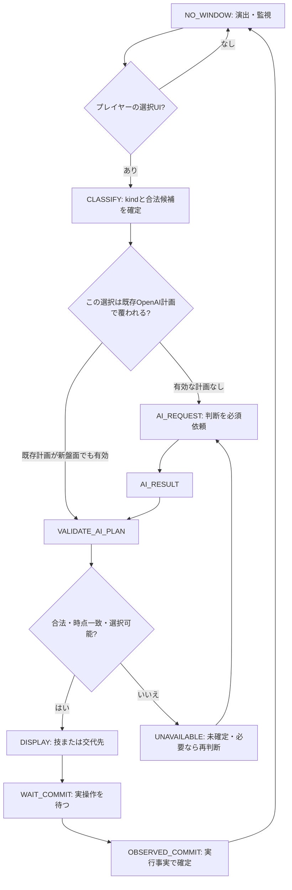

# Pokémon Champions リアルタイムAI対戦支援｜S05 対戦中 詳細状態遷移 v1.2

- 作成日：2026-10-21
- 対象：Windows / Androidエミュレータ / Champions シングル・ランクマッチ
- 上位設計：`Pokemon_Champions_State_Machine_Design_v1_1.md` の S05/D節を本仕様で置換
- 唯一正本（戦術的判断ルール）：`Pokemon_Champions_MC_live_decision_gate.txt`
- 現行構築：`Pokemon_Champions_MC_team_2026-10-03.csv`
- 設計方針：**戦術判断は常にOpenAI。ローカルは画面認識・事実更新・入力機会の分類・整合性検査・記録のみ。**
- 出典の区別：`ほえる` のランダム交代と `とんぼがえり` 等の自己交代はChampions専門資料により裏づけあり。他の発動・交代先の選択UIの細部は実機確認事項として扱い、過去作品の挙動から確定しない。

## 0. 従来設計からの変更点

1. `TURN` をAPIの単位にしない。**decision_window / action_window（プレイヤーの新しい意思決定入力窓）をAPIの単位**にする。
2. 「技・通常交代」「とんぼがえり等の交代先」「ひんし後の交代先」「道具・特性等で選択可能になった交代先」を異なる `window_kind` として認識する。
3. 「ほえる」等のランダム強制交代は **入力窓を発行しない**。出てきたポケモンを把握し、次の実入力窓でOpenAIに判断させる。
4. ターン番号、技使用回数、交代回数、画面遷移回数、API呼出し回数は別のカウンタ。
5. とんぼがえりなどの選択時はOpenAIが**交代技＋暫定交代先を同時に提案**する（既存LIVEゲートを遵守）。技実行後に選択窓が開いたら、実際の盤面と候補を確認して **その計画を採用できる場合のみAPI再呼出しを省略**。差分があればOpenAIに改めて交代先を判断させる。
6. 交代を発生させたイベント名だけで選択可否を断定せず、**実際の選択可能UIと合法候補**を優先する。
7. 選択窓がない状態で、技テキスト・HP・相手交代・状態異常を何度観測しても判断APIを発行しない。

## 1. 実装上の3つの独立した時計

- `game_turn_seq`：ゲームが表示・認識させるターン番号。明確でなければ暫定のターン識別子を用いる。
- `decision_seq`：自軍に実際の入力機会が発生するたびに増加。**1ターンに0回・1回・複数回ありえる。**
- `observation_seq`：画面からゲームイベントを確定するたび増加。入力機会がなくても増加する。

ひんし→死に出し→次ターンの技選択は `decision_seq` が2回増える。相手の「ほえる」だけでは増えない。とんぼがえり→交代先の選択は、同じ `game_turn_seq` の下で別 `decision_seq` になりうる。

## 2. S05を「観測FSM」「入力窓FSM」「APIジョブFSM」に分ける

### 2A 観測・戦闘進行FSM（ローカル）

| State | 名称 | 意味 | 基本API |
|---|---|---|---|
| `B00` | `BATTLE_ENTER` | 対戦開始、相手初手、選出3匹、PREP残存情報を取り込む | 0 |
| `B10` | `OBSERVE_BOARD` | 盤面・現在タイプ・HP・能力変化・優先度/行動順の事実を更新 | 0 |
| `B20` | `DETECT_CHOICE_UI` | 画面内の実入力UIと候補を安定認識し、入力窓を分類 | 0 |
| `B30` | `WAIT_PLAYER_ACTION` | 推奨表示後に実操作、技/交代確定を観測 | 0 |
| `B40` | `RESOLVE_ACTIONS` | 技・メガ・HP減少・効果・交代・ひんし等の演出とテキストを記録 | 0 |
| `B50` | `AUTO_FORCED_SWITCH` | ランダム強制交代や自動での盤面変更を取り込む（選択UIなし） | 0 |
| `B60` | `NEXT_PHASE_RECONCILE` | 演出後、次の入力窓/未完了演出/勝敗確定を判断 | 0 |
| `BX` | `SCREEN_UNCERTAIN` | UI曖昧、認識不一致、通信待ち。新判断の捏造禁止 | 原則0 |
| `B90` | `BATTLE_END` | 勝敗確定、対戦ジョブ失効、S06へ | 0 |

`B20` は画面が落ち着いた時だけではなく、技・交代演出中に操作可能な選択UIが現れた場合にも即時割り込める。`B40` 中のとんぼがえり交代先入力や、ひんし後の選択画面を見落とさないためである。

### 2B 入力窓FSM（イベントごとに生成）



| `window_kind` | 入力内容 | 主な発生条件 | OpenAI判断 |
|---|---|---|---|
| `NORMAL_COMMAND` | 技・メガ＋技・通常交代など | 行動選択メニューの表示 | 毎入力機会必須 |
| `PIVOT_TARGET` | 自分の交代技による交代先 | とんぼがえり/クイックターン/ボルトチェンジ/バトンタッチ/すてゼリフ等の成功後に選択UI表示 | OpenAI必須。直前のOpenAIによる有効な暫定指示を再利用可能 |
| `FAINT_REPLACEMENT` | ひんしに伴う新たなポケモン投入先 | 自軍ひんし後、交代先選択UI表示 | 毎入力機会必須 |
| `EFFECT_REPLACEMENT` | 道具/特性等による交代先 | 実際に交代先選択UIが表示された場合 | OpenAI必須。確認済み既存計画がなければ新呼出し |
| `OTHER_CHOICE` | 想定外の選択UI | 将来仕様や未網羅演出 | 何の操作か確定してOpenAI判断。捏造しない |

`FAINT_REPLACEMENT` 後に `NORMAL_COMMAND` が表示された場合は**別窓**であり、再度OpenAIへ技選択を依頼する。反対に、交代後すぐ新コマンドが出なければAPIは呼ばない。

### 2C APIジョブFSM

```text
NOT_NEEDED -> REQUESTED -> RUNNING -> RETURNED -> VALIDATING -> ACCEPTED
                                |                         |-> REJECTED_STALE
                                |                         |-> REJECTED_ILLEGAL
                                +-> TIMED_OUT / FAILED / CANCELLED
```

`match_id + decision_window_id + tactical_state_version + allowed_action_digest` をキーとして重複発注を防ぐ。回答はこの4要素が一致したときだけ画面に採用する。API失敗時にPythonが別技・別交代先を戦術判断してはいけない。

## 3. APIを呼ぶかを決める順序

**入力窓の発生時のみ**次の順序で処理する。

1. `MATCH_END_CONFIRMED` なら全ジョブ停止。選択を作らない。
2. 本当にこちらが操作できる選択UIか確かめる。相手の技のテキストや自動交代は選択UIではない。
3. UIの合法候補を抽出。`NORMAL_COMMAND`、`PIVOT_TARGET`、`FAINT_REPLACEMENT`、`EFFECT_REPLACEMENT`、未知UIに分類する。
4. 同じ入力窓の有効なOpenAI判断がすでにあるか確認。`PIVOT_TARGET` のみ直前の技判断に含まれた交代先計画を再利用できる可能性を評価する。
5. 新しい戦術的な決定が必要なら、**必ずOpenAIに依頼**。候補が1体しかない場合も、プレイヤーに明示選択させるUIなら原則OpenAIの確認対象とする（ゲームが自動で決める場合は不要）。
6. API結果を現在の合法手・技固定・使用可能技・現在タイプ・残り手持ち・入力窓IDで検査。
7. プレイヤー操作を観測してから実行済み状態へ進む。**OpenAIの提案そのものでは交代・技使用を確定しない。**

### 3A とんぼがえり系の二段階プロトコル

- 最初の `NORMAL_COMMAND` APIは `move=とんぼがえり` と `planned_pivot_target=アシレーヌ` のように **技と予定交代先を同時提示**。
- とんぼがえり実行前後に、相手が交代したか・相手が倒れたか・自軍が先に倒れたか・相手残り手持ち・HP・天候・特性・場・合法候補が変化したかをローカルで認識する。
- 実際に `PIVOT_TARGET` 画面が出て、**ターゲット・合法候補・温存条件・次の被弾順序に関連する差分がなければ**、すでにOpenAIが判断した予定交代先を採用できる。
- 盤面差分があれば、**そこでOpenAIへ新たな交代先判断**を依頼する。これが重要な追加APIポイント。
- 交代技が失敗・無効・発動せず選択UIが出ない場合は、予定交代先に関するAPI呼出しを発生させない。
- 先攻/後攻の違いにより交代先の着地リスクが変わるので、直前計画の再利用判定では相手の残行動可能性も確認。可否不明なら再利用しない。

### 3B ランダム強制交代について

Championsにおける `ほえる` / `ふきとばし` / `ドラゴンテール` / `ともえなげ` は、相手の控えから**ランダム**に交代させる効果と案内されている。**交代先決定のAPI呼出しは発生しない**。交代が実際に発動したか、誰が出たか、タイプ・特性・HP等を認識し、次の自軍入力窓で必ずOpenAIに判断を委ねる。

- 命中・効果発動がなければ自動交代イベントを生成しない。
- 相手の強制交代と同時に別の入力UIが発生した場合は、その**入力UIの種類**を根拠にOpenAI判断へ移行する。
- 強制交代されたことで従来の `active`、能力変化、こだわり技固定、メガ/フォーム依存の対面評価が変更される場合は、実測に基づき更新する。

### 3C 道具・特性による交代について

`だっしゅつボタン`、`ききかいひ` などは交代のトリガー候補として管理する。ただし**Championsで常にユーザーが交代先を選択できるかは今回の固定マスター記述だけでは確証不足**。技効果を検出しても、それだけで選択窓を作らない。

- 交代先選択UIが出現 → `EFFECT_REPLACEMENT` → OpenAI判断。
- ゲームが自動で交代させた → `AUTO_FORCED_SWITCH` → ローカル状態更新のみ。
- 画面が曖昧 → 一度再認識／必要なら操作確認、未知の仕様を仮定しない。

## 4. S05内部イベント一覧と状態遷移

| イベント | 開始状態→遷移先 | APIの要否 | 備考 |
|---|---|---|---|
| 初手を認識 | `B00 → B10` | なし | PREPはこの時点で強制終了 |
| 通常コマンドUIを認識 | `B20 → NORMAL_COMMAND` | **必須** | 技と通常交代を同時比較 |
| 技を選択した事実を認識 | `WAIT_COMMIT → B40` | なし | 技固定等を観測事実として反映 |
| プレイヤーの通常交代が成立 | `WAIT_COMMIT → B40` | なし | 新登場ポケモンを認識 |
| とんぼがえり等が実行 | `B40 → B20` または `B60` | まだ不要 | 交代先UI有無を調べる |
| 自軍交代先UI出現 | `B20 → PIVOT_TARGET` | **必要** | 既存OpenAI計画が有効なら再利用可能 |
| 交代先が実際に登場 | `PIVOT_TARGET → B40` | なし | 次ターンまで技入力が出なければ判断不要 |
| 自軍がひんし | `B40 → B20` | まだ不要 | ゲームが交代UIを出すか確認 |
| ひんし後の交代UI出現 | `B20 → FAINT_REPLACEMENT` | **必須** | 控え全員と相手残り全体を比較 |
| 死に出し後の通常コマンドUI | `B20 → NORMAL_COMMAND` | **必須** | 死に出しとは別の判断窓 |
| 相手の通常交代 | `B40 → B10` | なし | 状態更新。次の入力窓で判断 |
| 相手のとんぼがえり交代 | `B40 → B10` | なし | 出てきた相手を観測 |
| 相手のほえるが発動 | `B40 → B50` | なし | ランダム交代結果を追跡 |
| 相手ほえる後に通常コマンドUI | `B50 → NORMAL_COMMAND` | **必須** | 新しい対面・現在自軍で技選択 |
| 自軍の道具・特性交代効果 | `B40 → B20/B50` | UI次第 | 選べるならAI、ランダム・自動なら不要 |
| ターン終了時の毒・天候ダメージ | `B40 → B10/B20` | なし | ひんし→交代UIが出れば別判断 |
| 同時ひんし | `B40 → B20/B90` | UI次第 | 勝敗/交代の表示を確認 |
| 勝敗表示を確認 | `ANY → B90 → S06` | なし | 未処理回答を無効化 |
| UI種別を確定できない | `ANY → BX` | 原則なし | 推奨をでっち上げない |

## 5. ケース別シーケンス

### ケースA：通常ターンで「じしん」を選ぶ

```text
B20 通常コマンド確認
 → [API #1 NORMAL_COMMAND] OpenAI「じしん。」
 → 推奨表示 → プレイヤー操作
 → B40 じしん・相手行動・HPを観測（API 0）
 → B60 新コマンド出現待機
 → 次ターン B20 → [API #2 NORMAL_COMMAND]
```

### ケースB：とんぼがえり後、予定どおり交代できる

```text
B20 通常コマンド確認
 → [API #1 NORMAL_COMMAND] OpenAI「とんぼがえり → アシレーヌ。」
 → とんぼがえり実行・ダメージ観測
 → PIVOT_TARGET画面出現
 → 差分なし、予定交代先合法・有効を検査
 → 既存OpenAI判断を再利用（追加API 0）
 → アシレーヌ登場を観測 → 次の入力窓まで待機
```

### ケースC：とんぼがえりの後に相手の状態が変わった

```text
B20 通常コマンド確認
 → [API #1 NORMAL_COMMAND] OpenAI「とんぼがえり → アシレーヌ。」
 → 相手の行動・交代・ひんし・被弾順序など重要変化を観測
 → PIVOT_TARGET画面出現 / 予定交代先の有効性が不明
 → [API #2 PIVOT_TARGET] OpenAIが最新盤面で交代先再判断
 → 交代先表示 → 実際の登場を観測
```

### ケースD：相手の「ほえる」でこちらがランダム交代

```text
B40 相手「ほえる」を観測
 → B50 ランダム交代演出・登場した自軍ポケモンを確認（API 0）
 → 現在タイプ・HP・特性・能力変化・交代による固定解除等を更新
 → B20 次の通常コマンド画面を確認
 → [API #1 NORMAL_COMMAND] 新しいポケモンで行動判断
```

**ほえる発動中に「交代先を選べる」という前提を置かない。**

### ケースE：自軍が倒されて死に出し、その後の技を選択

```text
B40 自軍ひんしを検知（API 0）
 → B20 FAINT_REPLACEMENT 画面確認
 → [API #1 FAINT_REPLACEMENT] OpenAI「ミミッキュを出す。」
 → ミミッキュ登場を観測（API 0）
 → 盤面の変化・相手の残り・ばけのかわ等を更新
 → B20 NORMAL_COMMAND 画面確認
 → [API #2 NORMAL_COMMAND] OpenAI「じゃれつく。」
```

出すポケモンと技の2つは、局面次第でゲーム内部の別入力窓となる。**同じターン内でも2回の独立したOpenAI判断を認める**。選出3匹の温存方針は両者へ渡し、ひんし後の出し先だけで手持ち全体を判断したことにしない。

### ケースF：ターン終了時ダメージでひんし

```text
B40 ターン終了効果でHP 0
 → B20 FAINT_REPLACEMENT 画面確認
 → OpenAIに投入先を相談
 → 次のコマンド画面が出た時に改めてOpenAIへ技選択
```

### ケースG：道具・特性が交代を起こす

```text
B40 特性/道具発動のメッセージを検知
 → B20 実際のUIの種類を確認
    ├─ 交代先を選択可能 → EFFECT_REPLACEMENT → OpenAI判断
    ├─ 自動交代演出のみ → B50 状態更新のみ
    └─ UI不明 → BX 認識再試行、勝手な交代先決定なし
```

### ケースH：相手が倒れ、こちらの入力窓がまだない

```text
B40 相手ひんし / 相手の次ポケモンを待機
 → B10 相手の登場を観測
 → B20 通常コマンド画面が出た時だけOpenAIへ行動判断
```

## 6. データモデル

### 6A `DecisionWindow`

```json
{
  "match_id": "match_20261021_001",
  "game_turn_seq": 5,
  "decision_window_id": "match_20261021_001:dw_009",
  "window_kind": "PIVOT_TARGET",
  "cause_event": "OUR_UTURN_RESOLVED",
  "tactical_state_version": 27,
  "allowed_actions": [
    {"kind": "SWITCH", "target": "アシレーヌ"},
    {"kind": "SWITCH", "target": "ミミッキュ"}
  ],
  "deadline_ms_remaining": null,
  "observation_confidence": "high",
  "ui_confirmed": true,
  "requires_strategic_decision": true
}
```

`deadline_ms_remaining=null` はゲーム側の当該交代入力時間がまだ読めていない状態を意味し、45秒などを推測代入しない。

### 6B `DecisionRequest`

```json
{
  "request_id": "req_009",
  "decision_window_id": "match_20261021_001:dw_009",
  "kind": "PIVOT_TARGET",
  "tactical_state_version": 27,
  "current_board": {
    "our_active": "マスカーニャ",
    "opponent_active": "ガブリアス",
    "opponent_hp": {"value": 39, "source": "estimated"},
    "opponent_action_pending": "unknown"
  },
  "available_switch_targets": ["アシレーヌ", "ミミッキュ"],
  "previous_ai_plan": {
    "move": "とんぼがえり",
    "planned_switch_target": "アシレーヌ"
  },
  "remaining_win_conditions": ["ガブリアスの処理役を温存"],
  "ask": "実際の盤面に基づき交代先を一つ選択"
}
```

これは**架空のデータ例**であり、実際の対戦・HP・型・推奨の記録ではない。

### 6C `DecisionResult`

```json
{
  "request_id": "req_009",
  "decision_window_id": "match_20261021_001:dw_009",
  "tactical_state_version": 27,
  "action_kind": "SWITCH",
  "switch_target": "ミミッキュ",
  "move": null,
  "mega": false,
  "warning": null
}
```

形式違反、合法候補にない交代先、既に倒れたポケモン、入力窓不一致、古いバージョンは**採用禁止**。ローカルはAIの代わりに別候補を選ばない。

## 7. 状態更新がAPIを発火させるかの判定

**観測イベントのみではAPIは発火しない。** 重要イベントは記録し、次の入力窓に最新値を含める。

| 情報の変化 | ローカル更新 | 新しいAPI |
|---|---:|---|
| HPバー減少・回復 | 必須 | 選択窓がなければ0 |
| こだわり固定の発生/解除 | 必須 | 次の選択窓で判断（既存判断中なら失効検討） |
| メガ・フォーム・タイプ変化 | 必須 | 同上 |
| 攻撃・特防・Sランクなどの変化 | 必須 | 同上 |
| 相手の使用技・道具判明 | 必須 | 同上 |
| 天候・フィールド・壁・設置技 | 必須 | 同上 |
| 強制交代・相手交代 | 必須 | 次の選択窓まで0 |
| とんぼがえり等で交代先UI表示 | 必須 | AI計画有効なら再利用、それ以外は新API |
| 死に出しの交代先UI表示 | 必須 | 新API |
| 死に出し後の通常コマンド | 必須 | 新API |
| 同じOCR文の連続検出 | 重複排除 | 0 |
| 勝敗確定 | 必須 | 対戦中は0。別途振り返り |

## 8. 締切・割り込み・整合性

- **各判断入力窓の実際の残り時間が最優先。** 通常技入力は既存LIVEゲートの目標5秒/変化時10秒/上限15秒を目指す。交代先選択窓に同じ15秒が保証されるとは仮定しない。
- OpenAI問い合わせ中に別の入力窓が出たら、古いジョブを失効し最新窓の判断を優先する。
- 特に `PIVOT_TARGET` への移行時、旧 `NORMAL_COMMAND` の回答を新しい指示として流用しない。**予定交代先フィールドだけを鮮度確認したうえで再利用可能**とする。
- 自軍が倒れてひんし後の選択画面が出たら、以前の技判断は無効。別 `FAINT_REPLACEMENT` を作る。
- 相手初手登場時にPREP継続ジョブがあるなら無効化し、実コマンドが出たら優先して戦術判断。
- 同じ入力窓のOCR揺れを別窓と誤認しないよう、UIの種類、合法候補、ゲーム側の状態遷移を組み合わせた安定判定を用いる。
- 判断結果はUIに表示しても実行済みではない。**実際のプレイヤー操作・技表示・交代結果から確定する。**
- 入力窓が終了した、あるいは選択期限を過ぎた後の回答は表示しない。
- `B90` 勝敗確定はすべてに優先。S06へ遷移した後は戦闘判断APIを発行しない。

## 9. APIの正しい使用回数の式

```text
API呼出し ≒ 選出 1
            + PREP 1
            + NORMAL_COMMAND の実判断数
            + PIVOT_TARGET の再判断数（既存AI計画再利用は0）
            + FAINT_REPLACEMENT の実判断数
            + EFFECT_REPLACEMENT の実判断数
            + 例外的な追加判断・再試行
            + 対戦後レビュー 1
```

**ターン数そのものを使ってAPI使用量を見積もらない。** また、「交代が起きた回数」もAPI回数と一致しない。ランダム強制交代や相手の交代などは通常APIを発生させない。

## 10. 推奨モジュール構成

```text
battle_event_classifier.py   生の画面変化→技/交代/ひんし/入力UIイベント
choice_window_detector.py    NORMAL / PIVOT / FAINT / EFFECT のUI判定
choice_window_fsm.py         decision_window_id・タイマー・操作完了管理
battle_observation_fsm.py    演出・ターン境界・ランダム交代・終了検知
battle_state_reducer.py      HP/タイプ/固定/観測行動の単方向更新
pivot_plan_validator.py      既存OpenAI暫定交代先の再利用可否判定
openai_decision_router.py    実判断が必要な入力窓だけをAPIへ
api_job_controller.py        リクエストID・期限・重複抑制・旧応答破棄
legal_action_validator.py    使用可能技/合法交代/入力窓一致を検証
ui_controller.py             短い技名/交代先と、認識・期限状態を表示
match_logger.py              画面イベント・API根拠・実操作を時系列記録
```

## 11. 受入テスト（最低15シナリオ）

| # | シナリオ | 合格条件 |
|---|---|---|
| 01 | 通常ターンに技選択 | OpenAI判断1件、次の選択窓までは追加なし |
| 02 | 通常ターンにハード交代 | OpenAI判断1件、実交代後に追加なし |
| 03 | とんぼがえり成功、予定どおり | 初回AIの交代先を再利用、余分なAPIなし |
| 04 | とんぼがえり後、相手交代や重要変化 | PIVOT_TARGETで再度OpenAI判断 |
| 05 | とんぼがえり失敗・交代UIなし | PIVOT_TARGETは生成しない |
| 06 | とんぼがえりで相手ひんし | 実際の選択UIを確認してから分岐 |
| 07 | こちらが先にひんし、技が不発 | ひんし後交代UIがあれば FAINT_REPLACEMENT |
| 08 | ひんし後に死に出し、その後コマンド | 2つの別窓、両方OpenAI判断 |
| 09 | 相手のほえる発動 | ランダム交代中の追加APIなし |
| 10 | ほえる不発 | ランダム交代を記録せず盤面維持 |
| 11 | ほえる後にコマンド画面 | 新自軍ポケモンの状態でOpenAI判断 |
| 12 | 相手のとんぼがえり | 交代演出ではAPIなし。次の入力窓で判断 |
| 13 | 特性/持ち物発動で交代先選択UI | EFFECT_REPLACEMENTでOpenAI判断 |
| 14 | 特性/持ち物による自動交代 | ローカル観測のみ、APIなし |
| 15 | ターン終端の定数ダメージでひんし | 死に出し窓でOpenAI、次コマンドで再度OpenAI |
| 16 | 両者ひんし・勝敗確定 | RESULTが最優先、誤った交代APIなし |
| 17 | API中に新しい選択窓へ遷移 | 旧応答を無効化し新窓だけ有効 |
| 18 | 認識しづらい選択画面 | 未確定とし、勝手な交代先や技を生成しない |
| 19 | 画面アニメーション中OCRが連続変化 | 認識更新のみ、API呼出し0 |
| 20 | 対戦終了後に遅れたAPI回答到着 | 表示されず、次戦に混入しない |

## 12. 仕様ソース・未確認事項

確認できたChampions専用情報：

- ほえる：相手の控えからランダムに交代する（https://gamewith.jp/pokemon-champions/554423 / https://ftp.serebii.net/attackdex-champions/roar.shtml）。
- 交代技、とんぼがえり、クイックターン、ボルトチェンジ、すてゼリフ、バトンタッチ等：自己交代の効果（https://gamewith.jp/pokemon-champions/558723）。
- ふきとばし/ドラゴンテール/ともえなげ：相手をランダムに交代させる（同上）。
- ききかいひ：HP半分以下で手持ちに戻る（https://gamewith.jp/pokemon-champions/575011）。
- プロジェクト固定マスター：`Pokemon_Champions_MC_move_master.csv` / `Pokemon_Champions_MC_ability_master.csv` / `Pokemon_Champions_MC_usable_held_items.csv`。

実機で確認すべき事項（推測で埋めない）：

1. Androidエミュレータ版における、交代先選択UIの見た目と発生タイミング。
2. だっしゅつボタン、ききかいひなどによる交代時の選択UIの有無。
3. とんぼがえり等の技失敗・相手ひんし・同時ひんし・後続1匹時の分岐。
4. 交代先選択時の表示タイマーと、通常45秒の技選択時間との関係。
5. 死に出し後に同一ゲームターン内で再度コマンドが出るか、その表示条件。
6. フェイント等、選択画面に似ていて実際には操作不能な演出の識別。

> 本仕様は「何が実際にプレイヤー入力可能か」というUI事実を優先し、ゲーム仕様が未確認でも誤ったAPIタイミングを生成しにくい設計である。設計上の判断条件と、ゲーム内の確認済み挙動は必ず区別する。
