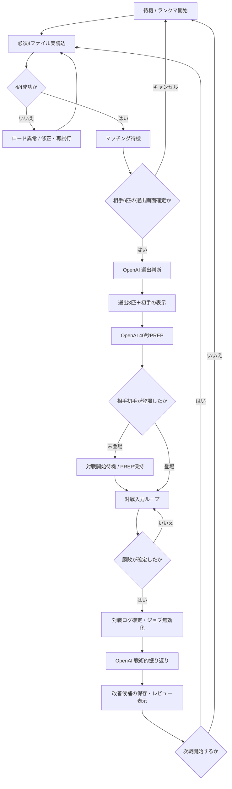
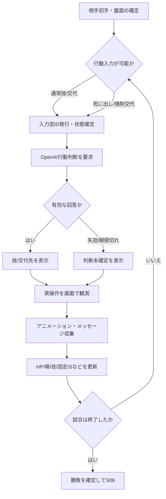

# Pokémon Champions リアルタイムAI対戦支援｜状態遷移設計 v1.1

- 作成日：2026-10-21
- 適用範囲：Windows / Androidエミュレータ / Pokémon Champions シングル・ランクマッチ
- 関連設計：`Pokemon_Champions_Realtime_AI_System_Design_v1_0.md`
- 正本：`Pokemon_Champions_MC_live_decision_gate.txt`（LIVE判断の唯一正本）
- 現行構築：`Pokemon_Champions_MC_team_2026-10-03.csv`
- 方針：**戦術判断（選出・PREP・行動・対戦後の戦術的振り返り）はOpenAIが実施する。ローカルは認識・状態管理・ファイル参照・結果検証・記録を担当する。**
- 備考：これは提案仕様。実際の画面イベント名称や表示タイミング、応答時間は実機試験で確定する。

## A. 状態機械を三層に分離する

1. **試合ライフサイクル FSM**：開始→ロード→マッチング→選出→PREP→対戦→勝敗→振り返り→次戦。
2. **対戦入力 FSM**：相手初手の確定→自分の行動入力→推奨待機→操作→アニメーション→盤面更新→次の入力／強制交代。
3. **OpenAIジョブ FSM**：未送信→送信中→受信・検証→採用／破棄／タイムアウト。API通信を画面遷移の成否と混同しない。

ゲーム側の画面はAPIと無関係に進むため、単一の巨大な直列処理にしない。ゲーム側のイベントを最優先してジョブを中断できるようにする。

## B. 全体フロー



**優先割り込み：** `MATCH_END_CONFIRMED` は対戦中の全ジョブに優先。`OPPONENT_LEAD_CONFIRMED` はPREPを即終了。`NEW_ACTION_WINDOW` は古いターン結果より優先する。`UNKNOWN_SCREEN` はそれだけで試合終了と判定しない。

## C. ライフサイクル状態定義

| ID | 状態 | entry処理（ローカル） | OpenAI | 正常なexit条件 | 次状態 |
|---|---|---|---|---|---|
| S00 | `IDLE`待機 | 未終了ジョブなし、ユーザーの開始操作待ち | なし | `START_MATCH` | S01 |
| S01 | `PRELOADING` | 毎試合4ファイルの**本文**を実読込、358行対応・現行構築を検査、索引構築 | なし | `PRELOAD_4_OK` | S02 |
| S01-E | `LOAD_ERROR` | 欠損・キー不一致を表示。完了表示禁止 | なし | 修復後 `RETRY_PRELOAD` | S01 |
| S02 | `MATCHMAKING` | エミュレータ監視、開始時刻確定、画面遷移検出 | なし | `OPPONENT_SIX_CONFIRMED` | S03 |
| S03 | `SELECTING` | 相手6匹を正規名・フォーム込みで確定、マトリクス6行一括抽出、選出時間計測 | **選出判断1回** | 有効な選出回答表示 | S04 |
| S04 | `PREPARING` | 推奨3匹＋初手を表示直後に40秒計時開始、キャッシュ6行から18対面を抽出 | **PREP判断1回** | 18対面＋WIN3完了／40秒到達／初手登場 | S05 |
| S05 | `BATTLE` | バトルFSMを起動。各行動入力画面を待つ | 各行動選択時**必ず**判断 | `MATCH_END_CONFIRMED` | S06 |
| S06 | `FINALIZING` | 最終盤面・実行行動・勝敗・認識の不明点を確定、対戦ジョブを失効、ログをスナップショット化 | なし | `MATCH_LOG_SEALED` | S07 |
| S07 | `REVIEWING` | 対戦中に見えていた情報を時点別に再構成、判断品質と認識品質を分離 | **振り返り判断1回（標準）** | `REVIEW_ACCEPTED`／明示スキップ | S08 |
| S08 | `REMATCH_READY` | 改善候補を保留保存、UIに振り返り表示、次戦確認 | なし | `NEXT_MATCH` | S01 |

- `S02` のマッチングが成立せず取り消されたら、新たな試合に入っていなければ `S00` へ戻す。
- `S03` の選出画面で、相手6匹を認識できない場合はユーザー修正待ち。期限が来てもローカルで選出技術判断を代行せず、`DECISION_UNAVAILABLE` を記録する。
- `S03→S04` は「OpenAIの選出結果を出した直後」。ゲーム上の選出完了ボタン押下を待ってPREP開始しない。
- `S04` は選出確定を並行監視。ゲーム内の実選出が提案と異なる場合はPREPキャッシュを失効させる。時間が残れば**実選出を使ったOpenAI PREP**を再依頼し、初手登場なら中断する。**選出変更そのものをAIから提案し直さない**。
- `S04` がPREPを終えても相手の初手が現れない場合は待機する。選出画面が消えただけでは対戦を開始しない。
- `S06` のログ確定はローカルで完結する。OpenAIの詳細分析は `S07` で行う。
- `S08→S01` では、**前試合のキャッシュが存在しても、次の開始指示として必須4ファイルの本文実読込を改めて行う**。前試合に紐づく記録は新試合の状態へ持ち込まない。

## D. バトル内状態遷移（S05の子FSM）



### D1. 子状態の厳密定義

| 子状態 | 呼び出し条件 | すべきこと | API |
|---|---|---|---|
| `WAIT_BOARD` | 初手/交代/演出直後 | 画面が安定し、技・能力・HP・盤面情報が確定するまで観測 | 0 |
| `INPUT_READY` | 技選択または交代選択ができる | 新しい `action_window_id` と盤面スナップショットを作成 | 0 |
| `AWAIT_AI` | 入力窓につき未判断 | OpenAIに行動選択を問い合わせる | 1 |
| `ACTION_DISPLAYED` | 回答が有効 | 技／交代先を短く表示する。指示を出しただけでは使用済みにしない | 0 |
| `WAIT_EXECUTION` | 推奨表示後 | プレイヤーが入力した技または交代が画面で観測されるのを待つ | 0 |
| `RESOLVING_TURN` | 技・交代・効果演出 | 技名、行動順、メガ/フォーム、持ち物、天候、ひんし等を**途中フレーム含め記録** | 0 |
| `UPDATE_STATE` | 演出完了または次入力窓出現 | 観測事実を反映し、使用技による技固定・交代解除などを管理 | 0 |
| `DECISION_UNAVAILABLE` | API失効・失敗・期限切れ | 推奨なし。必要な場合は再度OpenAIへ問い合わせるが、Pythonは代替戦術を出さない | 0〜1 |

**通常入力と強制交代は別の入力窓。** 同じターン内でも、瀕死・強制交代後に新たな入力操作が必要ならOpenAIの判断対象。逆に、演出中にOCRのテキストが10回変わっても、入力画面がなければAPIを呼ばない。

### D2. 選出・ターン判断の締切

- 選出：OpenAI応答の目標10〜15秒、20秒ハード上限（ゲーム選出画面の90秒に対し余裕を確保）。
- PREP：OpenAIが初手6＋控え12＋WIN3を検証し、**選出表示直後から40秒**で強制終了。相手初手登場なら待たずに中断。未完成は `PREP_UNFINISHED`。
- ターン：通常5秒、状態変化時10秒目標、15秒ハード上限（ゲーム45秒）。
- 画面認識・API通信の実測時間は未確認。目標達成できない場合でも、誤った『完了』や期限後の古い指示を表示しない。

## E. OpenAIジョブ状態（直交するサブFSM）

```text
IDLE -> QUEUED -> RUNNING -> VALIDATING -> ACCEPTED
                  |           |             |
                  |           |             +-- REJECTED_INVALID
                  |           +-- STALE/CANCELLED/TIMEOUT
                  +-- CANCELLED_BEFORE_SEND
```

**APIジョブは `SELECT / PREP / TURN / REVIEW` の4種類。** 画像取得・OCR・相手交代の記録だけでは新たなOpenAIジョブを作らない。システム内のローカル統合イベントをトリガーにする。

| Job | 作成トリガー | 必要データ | 優先度 | 採用条件 |
|---|---|---|---|---|
| `SELECT` | 相手6匹の安定認識 | 相手6行・現行自軍・選出ルール | 高 | 試合ID一致、まだ選出画面、有効な3匹＋初手 |
| `PREP` | 選出回答直後 | 対応済6行・選出3匹・判断ゲート | 中 | 選出一致、相手初手未登場、18対面＋WIN3が完成 |
| `TURN` | 新しい入力窓確定 | 最新盤面・実測履歴・保持PREP・使用可能技 | **最高** | 試合ID・入力窓・状態バージョンがすべて一致、行動の合法性検証済み |
| `REVIEW` | ログを閉じた後 | 試合スナップショット・当時の情報・支援判断履歴 | 低 | 終了済み試合のID一致、レビュー形式が正しい |

- 応答採用前に `match_id / request_id / action_window_id / state_version / phase` を再検査する。選出・PREP・レビューでは不要なIDは任意だが、試合IDと対象フェーズの検査は必須。
- **同じ入力窓かつ同じ戦術状態への二重送信を防止**。OCRノイズだけでは `state_version` を増やさない。重要なHP変動、現在タイプ変更、メガ、使用技、固定、天候、先制、相手の正体等で変更する。
- `MATCH_END_CONFIRMED`：進行中の `TURN` と `PREP` を無効化。遅れて届いた結果はUIへ表示しない。
- `OPPONENT_LEAD_CONFIRMED`：`PREP` を中断し、必要なら `TURN` を優先。中断時点の未完成を正確に記録する。
- `NEW_ACTION_WINDOW`：旧窓の `TURN` 応答を失効。新しい窓でOpenAI判断を行う。
- `REVIEW` 実行中の `NEXT_MATCH`：旧試合レビューを新試合に混入させない。ユーザーが次戦を優先する場合、レビューを未完了として保留し、新試合の実ロードを優先。

## F. 代表的なイベントとガード

| イベント | 発火元 | 確認条件（ガード） | 注意 |
|---|---|---|---|
| `START_MATCH` | ユーザー操作 | 試合未進行、前試合情報を保存済み | 必須4ファイルの本文再読込を必ず実施 |
| `PRELOAD_4_OK` | ローカルローダー | 4本文の取得成功、必要な整合性確認 | 失敗時に完了宣言をしない |
| `OPPONENT_SIX_CONFIRMED` | 選出画面認識 | 重複・フォーム・名前曖昧性解消 | 誤認識は手動補正可能 |
| `SELECTION_REPLIED` | OpenAI結果検証 | 有効な3匹と初手、選出可能な味方のみ | 返答直後にPREP開始 |
| `SELECTION_LOCKED` | ゲーム画面 | 実際の3匹と初手が判定可能 | OpenAI回答とズレればPREP失効 |
| `OPPONENT_LEAD_CONFIRMED` | ゲーム画面 | フィールド上の相手初手を確認 | PREP即中止、TURN優先 |
| `TURN_INPUT_READY` | ゲーム画面 | 操作可能・盤面入力値が安定 | 窓IDごとに判断1回を基本とする |
| `OBSERVED_ACTION` | ゲーム画面 | 行動／技／交代が実際に発生 | AI推奨＝実行済みではない |
| `FORCED_SWITCH_READY` | ゲーム画面 | ひんし／強制交代などに伴う実入力可能 | 通常技選択とは別の判断窓 |
| `MATCH_END_CONFIRMED` | 終了画面＋履歴 | 勝敗表示または信頼できる終了確定 | 不明画面だけで終了扱いにしない |
| `REVIEW_ACCEPTED` | OpenAI結果検証 | 時点別の情報・支援/操作/構築問題の区分 | O/Xは振り返り段階に限定 |
| `NEXT_MATCH` | ユーザー操作 | 現試合ログ確定、重複開始なし | 新match_idと4本文再読込 |

## G. 観測情報とゲーム真実の管理

```text
raw_frame -> observation_candidate -> stable_observation -> canonical_state
                   |                     |
                   +-- low confidence -> manual correction / unknown
```

- `observed / estimated / unknown` を区別する。HPバーの読み取りは推定、技名表示は観測事実。採用率は相手の確定型情報にしない。
- 現在の状態と**観測済みイベント履歴を別々に永続化**する。後の技・特性の判明から過去時点の意思決定条件を勝手に書き換えない。
- メガ・フォーム・タイプ変化、こだわり固定（技使用から交代まで）、能力変化、S関係、持ち物消費などは観測時点から反映。過去作知識で補完しない。
- 同一戦況でも異なる `action_window_id` は異なる意思決定点。逆に同一窓内のフレーム変化だけでは多重API呼出しをしない。
- 画面認識が不安定なときは `UNKNOWN_SCREEN` を付けて再観測する。ただし、直近の有効なターン入力時間を浪費しないよう重要情報のみ優先確認する。

## H. 対戦終了→振り返り→再マッチングの厳密な流れ

**S06: 試合を閉じる**

1. 勝敗を表示から確定し、得失点・試合ID・終了時刻を記録。
2. 発行済みOpenAIジョブを無効化し、旧推奨の表示を消す。
3. 相手6・相手判明選出・自軍3・初手・各行動・HP・判明技/道具/特性・S・メガ・場の状態・各API判断と実際の入力・時間・認識信頼度を**不変スナップショット**として保存。
4. 画面観測が不完全で勝敗が判定できなければ `RESULT_UNCERTAIN` として確認を促し、勝敗を推測確定しない。

**S07: 試合後のOpenAIレビュー（標準1回）**

- 入力：不変スナップショット、ターンごとの「その時点で既知だった情報」、既存ゲート、判明後の結果を区別した履歴。
- 出力：`result / selection_review / lead_review / critical_turns / win_loss_causes / information_handling / risk_management / team_issue / player_execution_issue / assistant_decision_issue / perception_issue / next_actions / OX_candidates`。
- 評価：既存ゲート違反なら「既存ルール実行ミス」、それで防げない新発見のみO/X改善候補にする。O/Xは**試合後限定**。結果論や後から判明した型で当時の判断を断罪しない。
- 既存構築やマトリクスを**1試合の結果だけで自動変更しない**。改善は候補として保存し、複数試合で検証する。
- 出力はまず短い総括、必要時だけ詳細展開。試合後に限り時間のかかる検証や最新環境参照を許可するが、通常レビューの1回目はローカルログを主入力とする。

**S08: 次戦への移行**

- 前試合のレビュー状態 `review_complete / review_pending / review_skipped` を保存。
- 次戦準備では前試合の `match_id / opponent_six / actual_three / active / hp / choice_lock / known_moves / board / timeouts / pending jobs / PREP cache` を**新試合へコピーしない**。
- 長期統計は別集計DBへ継続保持（勝率・認識失敗・選出事故・同一ミス・PREP遅延・API応答時間）。
- 次の `NEXT_MATCH` は新しい `match_id` を割り当てる。必須4ファイルを**その開始指示の処理で実読込**し、成功確認後にマッチング待機する。
- レビュー中にユーザーが「次戦優先」を選んだ場合は、旧試合レビューを中断・保留として保存し、新たな試合準備へ進む。保留レビューは新試合中のリアルタイム判断をブロックしない。

## I. エラー・例外・復帰

| 事象 | 対応 | 復帰先 |
|---|---|---|
| ファイル読込失敗 | `LOAD_ERROR`、完了表示せず修正待ち | S01 |
| マッチングキャンセル | まだ対戦無し。ローカルで画面復帰を確認 | S00/S02 |
| 選出画面のOCR失敗 | 不明表示、手動修正。OpenAIに誤った確定6匹を送らない | S03 |
| 選出API遅延/失敗 | 有効判断なしを表示。Pythonは選出しない | S03（期限時は失敗記録） |
| PREP中に相手初手登場 | PREP中断、未完成記録、戦闘入力へ | S05 |
| 自軍の実選出がAI推奨と異なる | 元PREP破棄、実選出で再PREP（残り時間次第） | S04/S05 |
| API 429/通信切断 | 残り期限内で許す場合のみ再試行。ローカル代案を出さない | 同じ入力窓/未確定 |
| 応答が戻る前に相手交代/フォルム変更 | 影響があるなら旧応答失効、新しい盤面で再判断 | S05 |
| 同じ画面の連続認識 | 重複イベント統合、同一入力窓に二重API呼出ししない | 現状態維持 |
| 予期しない画面/一時停止 | `SCREEN_UNCERTAIN`、証拠収集。試合終了と即断しない | 元状態 |
| 対戦終了の取りこぼし | 終了画面と履歴を確認、必要なら手動勝敗確定 | S06 |
| レビューAPI失敗 | 結果ログは失わず`review_pending`保存、必要時再試行 | S08 |
| レビュー中に再マッチ開始 | 新試合を優先、旧試合は不変ログとして隔離 | S01 |

## J. 状態遷移とAPI消費の実例

1. `START_MATCH` → 4ファイルロード（API 0）。
2. `MATCHMAKING` で画面監視（API 0）。
3. 相手6匹確定 → OpenAI選出（API 1）。
4. 選出結果表示→OpenAI PREP（API 1）。
5. 相手初手・コマンド画面→OpenAI初手行動（API 1）。
6. 実技・アニメーション・HP変化・交代テキストの追跡（API 0）。
7. 次の入力窓→OpenAI次行動（API 1）。
8. 勝敗確定→結果ログ確定（API 0）。
9. 対戦後レビュー→OpenAI振り返り（API 1）。
10. `NEXT_MATCH` → 4ファイルを改めて本文実読込（API 0）、新試合へ。

**API目安**：`選出1 + PREP1 + 行動入力窓の数 + レビュー1`。1試合で行動入力窓が10回なら合計13回が基本。再判断・再試行・例外画像認識は追加されうる。**ターン数と入力窓数は必ずしも一致しない**（強制交代があるため）。

## K. 主要不変条件・試験

- `INVARIANT_01`: 4ファイルの今回実読込4/4が証明できない場合、事前ロード完了と表示しない。
- `INVARIANT_02`: 選出/PREP/ターン/戦術レビューの**判断主体はOpenAI**。Pythonは代替戦術判断をしない。
- `INVARIANT_03`: マッチング開始後は試合用4ファイルを再読込しない（次試合開始時は再ロード必須）。
- `INVARIANT_04`: 同じ相手6匹はマトリクス6行を一括取得し、全件再検索しない。
- `INVARIANT_05`: PREPが完了と言えるのは初手6＋控え12＋勝ち筋3点が揃った場合だけ。40秒/相手初手で即終了。
- `INVARIANT_06`: OPENAI応答の `match_id / state_version / action_window_id` が最新入力窓と合わなければ表示しない。
- `INVARIANT_07`: `ACTION_DISPLAYED` は行動実行を意味しない。観測してから技使用・交代・固定を確定する。
- `INVARIANT_08`: ひんし等の強制交代も、行動選択が必要な新入力窓ならOpenAIに判断させる。
- `INVARIANT_09`: ログ・戦術レビュー・改善候補を区別し、戦術レビューが新試合の状態を汚染しない。
- `INVARIANT_10`: 実戦の判明状態がマスターより優先。別作品による欠損補完をしない。
- `INVARIANT_11`: レビューでは当時判明していた情報を保存したまま評価し、O/Xは対戦後だけ。
- `INVARIANT_12`: 推奨が返らなければ「判断未確定」。API節約を理由にローカルで技を決定しない。

## L. 実装モジュールと対応状態

```text
app_controller.py        S00〜S08 試合ライフサイクル
preload_service.py       S01の4ファイル実読込・検証
capture_service.py       画面キャプチャ・一時リングバッファ
perception_service.py    画面分類・OCR・アイコン識別・HP推定
event_reconciler.py      観測の安定化・重複除去・イベント生成
match_state_store.py     match_id / state_version / board / 履歴
battle_fsm.py            S05内の入力窓・実行・演出・交代管理
decision_dispatcher.py   OpenAIジョブの優先順位・期限・中断
openai_client.py         Responses API 呼出し・構造化返却
decision_validator.py    出力形式・技固定・盤面鮮度・使用可否
review_service.py        S06/S07 ログ固定・振り返り・改善候補
ui_controller.py         現在状態・推奨・認識修正・次戦操作
```

**開発時の最優先テスト**：録画データから `相手6匹 → 選出 → PREP途中に初手登場 → TURN → 技演出 → 強制交代 → ターン入力 → 勝敗 → レビュー → 次戦` を最後まで1回再生し、各状態でAPI回数・鮮度・ログが設計どおりであることを確認する。
