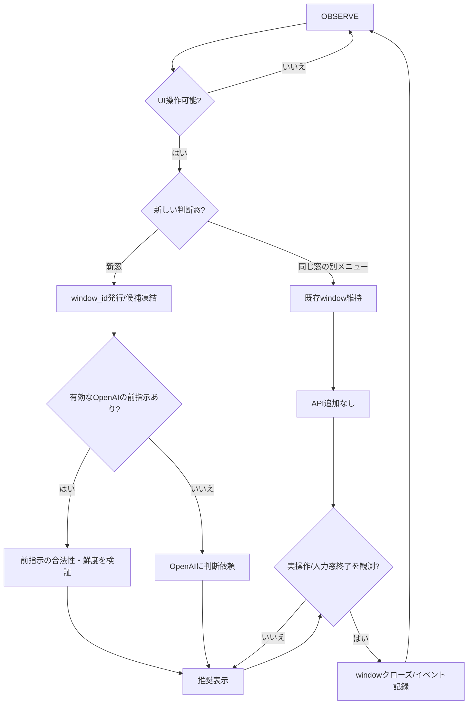

# Pokémon Champions リアルタイム対戦支援｜入力画面定義・検知仕様 v1.4

- 作成日: 2026-10-21
- 対象: Windows / BlueStacks等のAndroidエミュレータ / Pokémon Champions シングル・ランクマッチ
- 上位仕様: `Pokemon_Champions_State_Machine_Design_v1_1.md`、`Pokemon_Champions_S05_Battle_FSM_Design_v1_2.md`、`Pokemon_Champions_OpenAI_Prompt_Contract_v1_3.md`
- LIVE戦術ルールの唯一正本: `Pokemon_Champions_MC_live_decision_gate.txt`
- 設計原則: **戦術判断は常にOpenAI。ローカルはUI分類・観測・状態管理・合法性確認・重複抑止のみ。**
- 留保: Android版Championsの正確な画面レイアウト、ボタン座標、選択時の詳細遷移は実機画面で較正する。ここに示すROI、閾値、所要時間は**開発用の初期案**であり実測済みの製品仕様ではない。

## 1. 定義

**入力画面 / decision window**: プレイヤーがその瞬間に、新しい選出・技・通常交代・控え投入などの選択を確定できる状態。「画面にボタンが見えた」と同義ではない。ボタン/候補/入力可能性/ゲーム進行の根拠がそろった時に確定する。

**visual_ui**: スクリーン上で認識した描画カテゴリ。`TEAM_SELECTION`、`COMMAND_MENU`、`MOVE_MENU`、`PARTY_MENU`、`DETAIL_OVERLAY`、`ACTION_RESOLUTION`、`RESULT_SCREEN`、`UNKNOWN`。

**decision_kind**: 戦術上何を選択する機会か。`SELECT`、`NORMAL_COMMAND`、`PIVOT_TARGET`、`FAINT_REPLACEMENT`、`EFFECT_REPLACEMENT`、`OTHER_CHOICE`、`NONE`。

**decision_window_id**: 新しい判断機会ごとに一意のID。同じ意思決定の中でコマンドメニュー→技一覧→戻る→ポケモン一覧となっても変えない。選択の実コミット、強制的な終了、新たな入力機会まで同一。

**observation_seq**: 技の表示・HP変化などの事実観測ごとに進む。これだけでAPIを呼ばない。

**tactical_state_version**: 推奨に関係する事実/合法候補が変わるごとに更新。古いAPI結果を失効させる。

## 2. visual_uiとdecision_kindを混同しない

| visual_ui | 条件例（仮） | decision_kind | API |
|---|---|---|---|
| `TEAM_SELECTION` | 対戦前の相手6匹表示、選出操作枠/確定UI | `SELECT` | 相手6匹確定で1回 |
| `COMMAND_MENU` | 現在対面+自軍のコマンド群+操作可能表示 | `NORMAL_COMMAND` | 新窓で1回 |
| `MOVE_MENU` | 自軍技一覧・技説明を選べる | 上記窓の継続 | 再呼出ししない |
| `PARTY_MENU` | 自軍控え候補が表示 | 前イベントから分岐 | 下記表に従う |
| `DETAIL_OVERLAY` | ポケモン情報/技説明など | 元の窓の継続、または`NONE` | しない |
| `ACTION_RESOLUTION` | 技、ダメージ、交代、特性発動など | `NONE` | しない |
| `RESULT_SCREEN` | 勝敗または確定的な終了表示 | `NONE` | 戦術API停止、レビューへ |
| `UNKNOWN` | 識別不一致、重複UI、ロード中 | 未確定 | しない |

### `PARTY_MENU`の意味を決める根拠

| 直前の事実 | 推定するdecision_kind | 新API |
|---|---|---|
| `NORMAL_COMMAND`を開きユーザーがポケモン一覧へ移動 | `NORMAL_COMMAND`の継続 | 0 |
| 自軍のとんぼがえり等が成功し、選択UIが現れた | `PIVOT_TARGET` | 既存AI計画が有効なら0、それ以外は1 |
| 自軍ひんしを確認し、選択UIが現れた | `FAINT_REPLACEMENT` | 1 |
| 道具/特性による交代を確認し、選択UIが現れた | `EFFECT_REPLACEMENT` | 有効な既存計画がなければ1 |
| ほえる等によるランダム強制交代、選択UIなし | `NONE` | 0 |
| 原因の記録を欠き交代選択か情報画面か不明 | `UNKNOWN` | 保留／手動補正 |

**注:** わざの発動を認識しただけで交代先選択を確定しない。ゲーム内で実際の選択UIが観測できたことを優先する。Champions技マスターから技そのものは照合できるが、交代先UIの細部は実機検証する。

## 3. ローカル検出パイプライン

1. **キャプチャ**: BlueStacksのゲーム表示領域だけを取得。初期はADB、速度/安定性に問題があればWindows画面キャプチャへ切替。画面位置・スケーリング・レターボックスを補正し規格化する。
2. **安価な変化検知**: ROIごとのフレーム差分/知覚ハッシュ/動き量で画面遷移候補を抽出。毎フレーム全画面OCRはしない。
3. **UI形状検出**: 実機画面から切り出したUIテンプレートをOpenCV `matchTemplate` 等で照合。固定位置想定でなくゲーム表示領域に対する相対座標とアンカーを使う。必要ならローカル学習済み小型分類器を追加。
4. **文字/候補検出**: 入力候補のあるROIだけを日本語OCR。OCR結果はChampions現行構築の技名・控え名、相手6匹の候補名と照合。意味不明語を勝手に補正せず不明扱い。
5. **ゲーム進行文脈**: 直前イベント（選出確定、自軍交代技実行、ひんし、道具/特性発動、ほえる等）、現在HP、既知の自軍選出と照合。
6. **連続フレーム合意**: 数フレームに渡るUI構造と選択可能候補の一致を確認。初期実装では8～12fps監視、直近3枚中2枚で一致などを*仮パラメータ*にして調整。対戦時間が短いので不要な長時間デバウンスは禁止。
7. **入力機会FSM**: 新しいdecision_windowを開くか、既存窓継続か、無入力状態かを決める。
8. **戦術API**: 新しい判断が必要なら状態スナップショットを確定して送信。既存AI計画でカバーできる場合は再利用し、ローカルで新しい戦術を決めない。

### 検出で重視する領域（ROI、座標は実機較正）

- `ROI_UI_CONTROLS`: たたかう・ポケモン等の主コマンド領域
- `ROI_MOVE_CARDS`: 技一覧、PP、選択可否、メガ等の操作領域
- `ROI_PARTY_CARDS`: 控え候補・ひんし表示・選択可否
- `ROI_OPPONENT_TEAM`: 選出画面にある相手6匹
- `ROI_BATTLE_LOG`: ほえる、とんぼがえり、ひんし、特性、技使用テキスト
- `ROI_STATUS`: 双方HP・状態異常・能力変化・天候等の可視表示
- `ROI_RESULT`: 勝敗、切断・終了判定

## 4. 判定器の根拠と競合解消

入力窓を開くには最低でも次が必要:

- `game_context == IN_BATTLE`（選出時は`IN_SELECTION`）
- 操作可能な`visual_ui`の積極的証拠（UI形状 + テキスト/選択枠、または検証済み分類器）
- 表示候補と自軍状態の整合性（控え数/ひんし/技候補等）
- 一定の時間・フレームで安定（アニメ中の瞬間表示を除外）
- `decision_window_id` の重複なし

`PARTY_MENU`が出ても原因イベントが特定できない場合は勝手に`FAINT_REPLACEMENT`に倒さず`UNKNOWN`とする。ひんしが見えている／直前ログで確定なら`FAINT_REPLACEMENT`、とんぼ後なら`PIVOT_TARGET`、既存通常入力から開いたなら`NORMAL_COMMAND`継続とする。

OCRだけの低信頼イベントは**確定しない**。別フレーム、HP/演出、技ログ等の追加根拠で確認する。確信度の境界は録画検証で調整する。

## 5. 入力機会の開始・継続・終了



- **開始**: 主コマンドが実際に操作可能になった／交代先を実際に選べるようになった。
- **継続**: 技一覧→技詳細、主コマンド→ポケモン一覧→戻る、カーソル移動、選択やり直し。新APIなし。
- **終了**: 操作コミット確定（ゲームが技使用や交代の解決へ移った等）、入力制限時間終了、戦闘終了。単にサブメニューが閉じただけでは終了させない。
- **再開始**: 新たな入力機会が発生した時のみ新しい`window_id`を発行する。

## 6. APIリクエストに渡す検知結果の例

```json
{
  "match_id": "example-match-001",
  "decision_window_id": "dw-0010",
  "ui_observation": {
    "visual_ui": "PARTY_MENU",
    "decision_kind": "PIVOT_TARGET",
    "interactive_confirmed": true,
    "ui_confidence": 0.96,
    "candidate_source": "observed_ui_and_team_cache"
  },
  "trigger_event": {
    "event": "OWN_PIVOT_RESOLVED",
    "move": "とんぼがえり",
    "event_confidence": "confirmed"
  },
  "allowed_actions": {
    "switch_targets": ["アシレーヌ", "ミミッキュ"]
  },
  "previous_ai_plan": {
    "planned_pivot_target": "アシレーヌ",
    "validity": "RECHECK_REQUIRED"
  },
  "tactical_state_version": 19
}
```

このJSONのHP・候補・信頼度は*架空の説明値*。`ui_confidence`は戦術的に適切である確率ではなくUI分類器の校正値。API投入時は本例に加え、該当の盤面・温存対象・残り相手・判明技・入力時間を入れる。

## 7. 機械判定の疑似コード

```python
for frame in capture_stream():
    obs = observe_frame_locally(frame)  # ROI、OpenCV、OCR、差分抽出
    update_observation_log(obs)
    update_battle_facts(obs)  # 確認済み/推定/不明を区別

    ui = recognize_visual_ui(obs)  # 選択UI・アニメ・情報モーダル等
    if ui == "RESULT_SCREEN" and result_is_confirmed(obs):
        invalidate_pending_decisions()
        close_active_window(reason="match_end")
        enter_review()
        continue

    decision = classify_decision_window(
        visual_ui=ui,
        recent_events=recent_confirmed_events(),
        active_window=current_window(),
        legal_candidates=extract_confirmed_choices(obs),
    )
    if decision.kind in ("NONE", "UNKNOWN"):
        continue
    if not stable_and_interactive(decision):
        continue
    if is_same_window_or_submenu(decision, current_window()):
        continue

    window = open_new_decision_window(decision)
    prior = reusable_openai_plan(window, current_state())
    if prior is not None:
        display_if_legal_and_fresh(prior, window)
    else:
        request_openai_async(window, make_state_snapshot(window))
```

本番では`request_openai_async`の結果を受け取るスレッド/非同期処理側でも`match_id, window_id, tactical_state_version, allowed_action_digest`を照合する。画面とAPI通信は分離し、UI監視を止めない。`open_new_decision_window`は一度の新入力窓につき一回だけ実施する。**既存窓が閉じたかどうかの検出は、上記ループと並行するFSM側で処理する。**

## 8. 学習・検証用の録画データ

最初に必要なデータ（Androidエミュレータ、一定解像度）：

1. 選出画面の出現・確定・遷移（相手6匹識別）。
2. 通常コマンド・技一覧・技説明・通常のポケモン一覧・戻る操作。
3. とんぼがえり実行～交代先UI～投入完了（成功、失敗、相手が退場など複数条件）。
4. 自軍ひんし～死に出しUI～次の技選択UI。
5. ほえる等の強制交代～新ポケモン表示～次の技選択UI。
6. 道具・特性交代効果が実際に発動した場合のUI。
7. 対戦終了（勝ち・負け・通信切断・時間切れが収集できる範囲）。

単一静止画像だけでなく、**イベント直前から次入力までの連続録画**が必要。手作業で`visual_ui`、`decision_kind`、開始時刻、終了時刻、真の合法候補をラベル付けし、誤認識の原因を分析する。

## 9. 受入条件・優先テスト

- 通常コマンド→技一覧→詳細→戻るで**API1回**のまま。
- とんぼがえりで予定交代先有効なら追加API0、盤面差分で計画失効なら追加API1。
- ひんし後の交代先判断と次の技選択は**別window**で原則2回。
- ほえるによる自動ランダム交代ではAPI0。次の行動選択でAPI1。
- 相手交代・HP変化・技メッセージだけではAPI0。
- API回答待ちに新windowが発生したら旧回答を表示しない。
- 戦闘終了時に対戦中の保留APIを全失効。
- API失敗・UI未確定時にローカルが戦術判断しない。
- 認識ミスとOpenAI判断ミスを個別ログに分離。

## 10. 実装優先順位

1. 画面のトリミング・解像度固定・ROI設定。
2. `TEAM_SELECTION`, `COMMAND_MENU`, `MOVE_MENU`, `PARTY_MENU`, `ACTION_RESOLUTION`, `RESULT_SCREEN`の安定分類。
3. 入力窓IDと二重呼出し防止。
4. 直前イベント付き`PARTY_MENU`分類（通常/交代技/ひんし/効果）。
5. APIへ送るJSONと旧回答失効。
6. 録画リプレイによる実測精度・遅延評価。

実装上の最大リスクは`PARTY_MENU`の意味分類と、実操作コミットの誤判定である。画面描画だけでなく、前後のイベントを優先して解消する。
